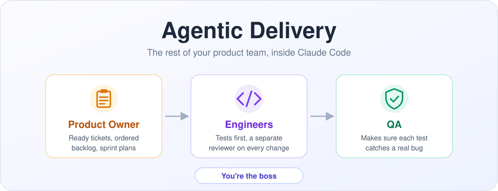
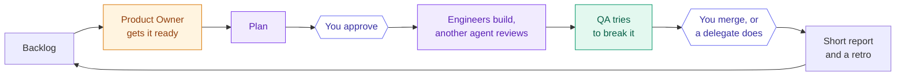

<div align="center">



[](LICENSE)


### Do the part you love. Agents do the rest.

Whoever you are on the team, you can now **build the whole product**, right inside Claude Code.

</div>

---

## TL;DR

- It's a Claude Code plugin that gives you **a team of agents**: a **Product Owner**, **engineers**,
  and **QA**.
- **You decide** on your part. The team handles everything else.
- Each feature comes back **tested and reviewed**, with **its real cost**.
- We use it **every day** on iOS and Flutter, and it has also built Go, Node, and React work.
- **Try it in two commands**, then run `/feature`:

  ```bash
  claude plugin marketplace add kkunan/agentic-delivery
  claude plugin install agentic-delivery@agentic-delivery
  ```

## Why we built it

AI can write code fast. But a feature takes more than code, and you know how it goes. The ticket
is **one vague line**. The agent either asks you about every tiny thing, or goes quiet for an hour
and comes back with **something else**. Then it says "all tests pass", and you end up **checking everything yourself** anyway.

So we gave the agent **a team**.

<table>
<tr>
<td width="33%" valign="top">


**Product Owner**

Turns "add a profile page" into a **real ticket**: the goal, who it's for, and how you'll know it's
done. Keeps the backlog in order, plans sprints, and brings you **its best pick** instead of a list of questions.

</td>
<td width="33%" valign="top">


**Engineers**

Write **the test first**, then the code. **Never fake a test** to get a green tick. Work in parallel when
it's safe, and **a different agent reviews** every change.

</td>
<td width="33%" valign="top">


**QA**

Checks **the plan before any code** exists. **Breaks the code on purpose** to see if the tests notice.
Won't let the pull request go out while **a check is still skipped**.

</td>
</tr>
</table>

## How a feature runs



At the end you get a pull request, a **one-minute report** with screenshots, and a retro that says **what
it really cost**. Don't want to be **the bottleneck**? Name **a delegate**, and it can approve and merge the
changes that users won't see.

## Who it's for

Whatever your role, you get **the rest of the team for free**. You stay in charge of your part, and
you approve it. The agents handle the parts you'd rather skip.

| If you're a... | You stay in charge of... | The team does the rest |
|---|---|---|
| **Product manager** | The roadmap and the big decisions | Turns them into tickets, then **builds and ships** them |
| **Product owner** | What matters most, and the final yes | **Writes ready tickets**, plans sprints, and builds them |
| **Designer** | How it looks | Turns your designs into **a working product**, and shows you each screen |
| **Engineer** | The plan and the merge | **Writes the tests and the code**, and gets every change reviewed |
| **QA** | The bar for "done" | **Checks the plan**, tries to break the code, and logs every check |
| **Tech lead** | The standards | **Follows them on every run**, and proposes fixes after |
| **Engineering manager** | The budget, and who signs off | **Delivers**, and reports what each ticket cost |
| **Solo builder** | The idea | **Everything else** |

## Where we use it

It was born on a **production iOS app**, with **more than 30 tickets** shipped through it. Now we
run it **every day** on iOS and Flutter work, and it has also built Go, Node, and React tasks.

| Platform | How ready |
|---|---|
| Flutter | Commands measured on real runs |
| Native iOS | Built from the real project, tested in CI |
| Go services | Tested in CI |
| Node services and Next.js web apps | Commands and mutation runner measured on real runs |
| Kotlin Multiplatform apps | Commands measured on a sample project. The mutation runner ran on real Gradle for the JVM, server, and iOS test tasks. Not measured: the stall watch with KMP, the runner and the `--tests` filter on the Android host and Wasm tasks, and the Chrome fallbacks. The skill lists the rest. No real project used it yet |
| Anything else | No special commands yet, but the team and its rules still work |

> [!NOTE]
> **Looking for pilot teams.** We use it every day, but no whole team has run it yet. Try it on
> your next ticket and [tell us how it went](https://github.com/kkunan/agentic-delivery/issues). We'll
> fix what you find.

## Try it

```bash
claude plugin marketplace add kkunan/agentic-delivery
```

```bash
claude plugin install agentic-delivery@agentic-delivery
```

Copy `templates/agentic-delivery.md` to `.claude/agentic-delivery.md`, fill in the blanks, and run
`/feature`. Setting it up for a team? See the [install guide](docs/install.md).

## Want the details?

[Install](docs/install.md) · [Project setup](docs/setup.md) · [How it runs](docs/how-it-runs.md) ·
[What's inside](docs/inside.md) · [Lessons behind each rule](lessons.md)

Ideas and fixes are welcome as pull requests. Run `bash tests/run-all.sh` first.
[MIT](LICENSE) licensed.

<details>
<summary>Where these claims come from</summary>

- More than 30 tickets: the native iOS project that the iOS layer comes from.
- Daily use: the maintainer's projects and work, as of October 2026.
- Flutter: two runs on Flutter 3.38.9 stable, recorded in the Flutter layer.
- iOS and Go: the CI workflows in `.github/workflows/`.
- Node: four real tickets in October 2026, recorded in the Node layer.
- Kotlin Multiplatform: one sample app run on one Mac on 2026-10-25, recorded in the KMP layer. It covers the JVM, Android host, iOS simulator, and Wasm browser tests, and the Android emulator and iOS simulator screens.
- No team pilot yet: no team ran a feature through version 0.8.0.

</details>
