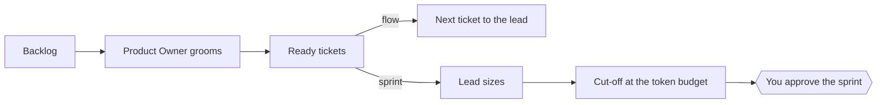
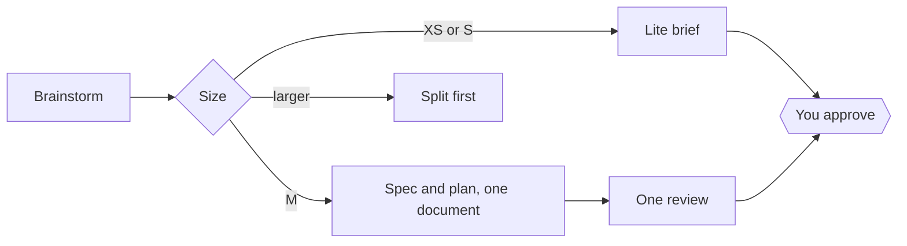
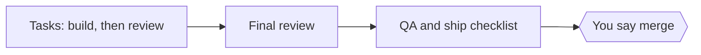
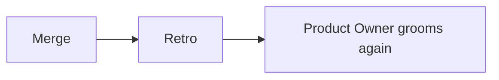

# How a feature runs, and who does what

This page gives the steps of a run in detail, and what each role does. The [README](../README.md) gives the short version.

## The steps

### 1. Pick the work

This step is optional. It runs only if the project file names a Product Owner. The Product Owner session needs the second plugin of the marketplace, `agentic-discovery`.

With `po_scope: product`, the Product Owner also prepares product decisions before the tickets. For
each decision, it shows you a short memo with options, the evidence for each, and its pick. You, or
the person whom the project file names, make the call. The Product Owner then writes the tickets.

### 2. Shape the work

### 3. Build

### 4. Land

Two steps need you: the plan, and the merge. Everything between them runs on its own. In sprint
mode, you also approve each sprint. A team with no Product Owner starts at the brainstorm, and its
run ends at the retro.

The size of the ticket picks the path. An XS or S ticket runs in lite mode by default: a short brief
replaces the spec and the plan, and one session does the work, with one review at the end. An M
ticket gets one document that holds the spec and the plan, and one review of it. A larger ticket is
split first. The controller skill gives the conditions.

## Each role

### Engineer
You run the pipeline for your own features.

1. Start a session at the root of the repository, and run `/feature` with the ticket or the idea.
2. Answer the brainstorm questions. The run writes a brief, or one document with the spec and the
   plan.
3. Read the plan and approve it. After that, the run works through the tasks without asking you.
4. When the pull request is ready, read the handoff, and say "merge" when you agree.

You can stop a run at any time. A status line that needs no answer is not a question for you.

### Tech lead
You own how the team works with the plugin.

- Write the project file once for each repository: branches, devices, test accounts, the tracker
  steps, and the actions that need a person's word.
- Review the pull requests that retros propose against the rules. A rule changes only through that
  review. Optionally, name a process owner in the project file who decides each process change.
- Read the cost lines in each ledger. They give real numbers for the next estimate.
- If the default agent does not know your stack, replace it with your team's own. Name it in the
  project file, and the run uses it for that seat.
- Optionally, name a delegate who approves plans that change nothing that a user sees.
- Optionally, name a merge delegate. It merges a pull request only if the checks pass, CI passes,
  the final review is clean, and nothing that a user sees changed beyond the approved plan.

### Product owner
You decide what a feature must do and how it must look. You can also name a Product Owner session
in the project file, which grooms and orders the backlog for you.

- Take part in the brainstorm, or give the engineer a ticket with clear acceptance rules.
- Each manual check in the plan states a value that can fail, so you can read the plan and know
  what "done" means.
- A plan that changes what a user sees comes to a person, even under a delegate. So does a merge
  that changes more than the approved plan shows.
- After the merge, read the feature report. It takes about one minute: the screens of each flow,
  side by side in one strip.
- With a Product Owner session, the run starts from a ready ticket: goal, user value, metric,
  acceptance, out of scope, open questions, and size. The run asks the engineer only for a field
  that is missing.
- In flow mode, the Product Owner sends the next ready ticket when a team is free. In sprint mode,
  it plans a batch with the lead. The lead gives each ticket a t-shirt size, and the sprint takes
  tickets until the token budget is full.
- When a run passes its estimate, stalls, or finds a blocker, the Product Owner replans with the
  lead.

### QA
You make sure that each check can fail.

- Before any code exists, the review of the document asks whether each check can fail. A ticket
  that touches a server contract can add the QA reviewer agent as a second seat.
- Manual checks go into the plan in a form that someone can disagree with, never "looks right".
- The run keeps a QA log that ends with a tally. The ready check refuses a branch with a check that
  did not run, unless a person waived it in writing.

### Designer
You give the visual source of truth.

- A spec that changes a screen gets a design review and an accessibility review.
- The pull request links a screenshot of each changed screen, taken on the final branch.
- A visual change beside an approved design always comes to a person.
